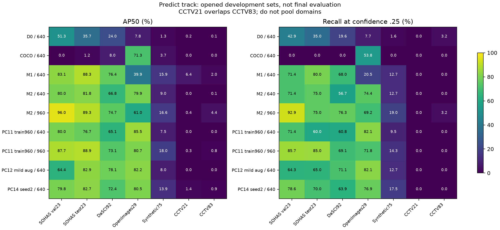
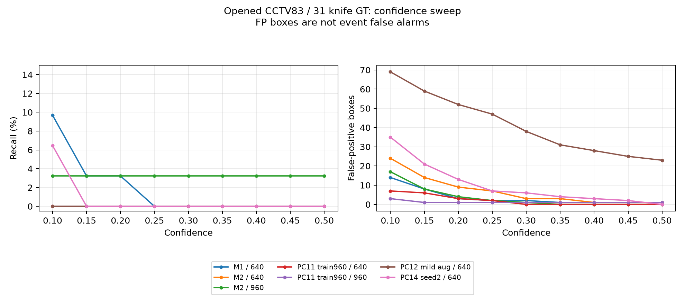

# M2 변형 공통 평가 — 2026-11-07

**PC11·12·14까지 같은 입력으로 평가했지만, 새 변형을 최종 CCTV detector로 채택할 근거는 부족하다.** 증강을 줄이면 일부 공개 자료의 점수가 좋아졌지만 CCTV 오탐이 크게 늘었다. 960 재학습도 CCTV 검출을 개선하지 못했다. 비교한 M1/M2 계열에서는 기존 M2를 960으로 **추론**한 조건만 confidence 0.25에서 31개 중 1개를 검출했다. 실용적인 목표를 달성했거나 최종 D*를 선정한 결과는 아니다.

## 1. 범위·실행 조건

- 사용자 승인: 완료된 세 모델을 M1·M2와 동일한 자료와 설정으로 평가한다. 학습·추론 해상도의 2×2 비교와 confidence 0.1~0.5의 P/R/F1/FP 변화를 기록하고, 개발 평가를 실제 Orin 및 독립 최종 평가와 구분한다.
- search-first: 기존 `run_detector_comparison.py`, `summarize_detector_comparison.py`, `evaluate_boxes`, COCO AP와 paired group bootstrap을 조합했다. 제품 코드·의존성·데이터 분할·운영 설정을 바꾸지 않고 [고정 실험 driver](evaluation-worker.py)와 [결과 검증/시각화](analyze-worker.py)만 추가했다.
- 평가 source commit `9de95cee0b12548219ea1e18e660300338327d28`, PC13의 격리 worktree/기존 `.venv-evaluation-20261104`, RTX3060 12GB, torch2.6.0+cu124/Ultralytics8.4.152, FP32·batch1·square letterbox·rect=False·NMSIoU.7·max_det300. class map은 checkpoint names로 검증했다. 실행 종료는 **11/07 22:54 KST**다([완료 state](evaluation-state.json)).
- 7개 개발 평가셋×9개 모델/해상도 조건×AP/predict2 tracks=126개 결과 partition이다. 9조건은7개 checkpoint를 사용한다. 각 조건은346개 image entries, 실제고유이미지는325개다. US21과 확대US83의21개가 겹치며 도메인을 pooling하거나 독립 표본으로 합산하지 않는다.
- 자료: SOHAS val23/14GT, SOHAS test23/20GT, DaSCI92/97GT, Open Images29/39GT, Simuletic75/63GT, US Mock21/8GT, 확대US83/31GT. 여기서 SOHAS test라는 이름도 이미 열린 개발 자료다. 학습의 raw val/test 각1,423장과 구분한다.
- 제공 라벨/기존 검수의 정답을 재사용했고 새 라벨·실사 촬영·Holding GT를 만들지 않았다. 검수 사이트/DB·원본·기존 결과·threshold 설정·Orin은 변경하지 않았다. 대용량 weight와 예측은 PC13에만 보관한다.

## 2. 학습 완료·반입 검증

M2의 기본·해상도·증강·seed 네 run 모두 50 epoch, 실제 37,150 updates와 `passed` 상태를 확인했다. 각 peer의 best.pt 해시를 원래 학습 기록과 대조하고 PC13 사본도 재검증했다. 같은 초기 pretrained n, 데이터와 고정 분할을 사용하며 아래 항목만 다르다.

| 장비 | 학습 | 초기 seed | 변화 |
|---|---|---:|---|
| PC13 | n640 | 20261004 | 기본M2 |
| PC11 | n960 | 20261004 | 학습해상도만 |
| PC12 | n640 | 20261004 | mosaic.5 / scale.5 / close_mosaic20 묶음 |
| PC14 | n640 | 20261107 | seed와 이에 따른 augmentation/반복추출 난수 |

[완료된 학습 설정·source commit·update·weight·manifest SHA](training-evidence.json). PC11/12의manifest는 기본M2와 같고, PC14는 seed에 따른4개 padding draw 선택/횟수로 manifest hash가 다르다. 고유 train11,884와val/test 각1,423은 동일하다. M1은train11,378·35,600updates, M2는88장 정제+OI594추가·37,150updates여서 M1→M2를 순수 데이터 추가/정제의 인과효과로 해석하지 않는다.

각 run의 native validation에서 선택한 best.pt를 비교했다. 960 run의 best 선택에는 960 native validation을 사용했다는 한계가 있다. 동일 epoch의 마지막 checkpoint 비교는 이번 범위에 추가하지 않았다.

## 3. 실제 predict 방식 비교

confidence는 0.25, 매칭 IoU는 0.5다. small은 normalized bbox area ≤ 0.02로 정의한다. 아래 값은 Recall이며 FP는 잘못 검출한 **box 수**다. 사건 단위 precision, 시간당 오경보, GPIO 지연과는 다른 지표다. Precision·F1·AP50/AP50–95·음성 이미지의 FP를 포함한 전체 9조건은 [CSV](predict-comparison.csv)에 있다.

| 조건 | SOHAS test R | DaSCI R | Open Images R | 합성 R | CCTV TP/31 | CCTV FP |
|---|---:|---:|---:|---:|---:|---:|
| M1 / 640 | 80.0% | 68.0% | 20.5% | 12.7% | 0/31 | 2 |
| M2 / 640 | 75.0% | 56.7% | 74.4% | 12.7% | 0/31 | 7 |
| M2 / 960 | 75.0% | 76.3% | 69.2% | 19.0% | 1/31 | 2 |
| PC11: 960학습 / 640추론 | 60.0% | 60.8% | 82.1% | 9.5% | 0/31 | 2 |
| PC11: 960학습 / 960추론 | 85.0% | 69.1% | 71.8% | 14.3% | 0/31 | 1 |
| PC12: 증강 완화 / 640 | 65.0% | 71.1% | 82.1% | 12.7% | 0/31 | 47 |
| PC14: seed2 / 640 | 70.0% | 63.9% | 76.9% | 17.5% | 0/31 | 7 |

- PC12는 DaSCI/OI에서 높은 Recall을 보였지만 확대 CCTV에서는 FP 47개가 나왔다. 음성 52장 중 27장에 FP 28개가 발생했다. 기본 M2는 전체 FP 7개, 음성 이미지의 FP 발생 2장이다. 공개 자료의 좋은 점수만으로 PC12를 채택하지 않는다.
- PC11의 960 학습·추론은 SOHAS test Recall 85%지만 CCTV에서는 0/31이다. 높은 학습 해상도가 항상 우수하거나 CCTV domain gap을 해결한다는 근거가 없다.
- PC14는 기본 M2 대비 DaSCI Recall 56.7→63.9%, SOHAS 75→70%, OI 74.4→76.9%로 source별 차이가 있다. 두 seed만으로 안정성이나 일반적인 우월성을 입증하지 않는다.
- AP track은 YOLO validator 방식의 per-class candidate를, predict는 실제 predict 방식의 candidate를 사용한다. 두 방식을 섞어 우열을 주장하지 않는다. [별도 AP CSV](ap-comparison.csv)와 [프로토콜](ap-models.json)을 보존한다. 위 표는 predict 결과이며 최종 사건 성능이 아니다.

기준 모델 D0는 확대 CCTV에서 TP 1/31·FP 83개, 기성 COCO26n은 TP 0/31·FP 0개였다. 두 모델을 포함한 전체 9조건은 CSV와 그림에 남겼다.

## 4. 해상도 2×2

기본 M2(640 학습)와 PC11(960 학습)을 각각 640/960으로 추론했다. 동일 checkpoint의 추론 해상도 변경과 재학습 효과를 분리한다. 아래는 확대 CCTV 83장 기준이다.

| 학습 | 추론 | TP/31 | FP | Recall | Precision | F1 |
|---|---:|---:|---:|---:|---:|---:|
| 640 | 640 | 0/31 | 7 | 0.0% | 0.0% | 0.0% |
| 640 | 960 | 1/31 | 2 | 3.2% | 33.3% | 5.9% |
| 960 | 640 | 0/31 | 2 | 0.0% | 0.0% | 0.0% |
| 960 | 960 | 0/31 | 1 | 0.0% | 0.0% | 0.0% |

M2의 960 추론은 DaSCI Recall도 56.7→76.3%로 올렸지만 OI는 74.4→69.2%로 내려갔다. 960을 최종 운영 해상도로 확정하지 않는다. 실제 Orin의 지연과 메모리는 측정하지 않았다.

## 5. Confidence sweep

0.10~0.50을 0.05 간격으로 계산했고, 낮은 점수의 후보를 진단할 0.001/0.05도 포함했다. 같은 confidence floor 0.001의 예측 캐시를 재사용했다. 추론을 반복하거나 현재 운영 threshold를 수정하지 않았다. [Predict 693행](predict-thresholds.csv), [AP 693행](ap-thresholds.csv)을 보존한다.

확대CCTV의TP/FP:

| 조건 | .10 TP/FP | .25 TP/FP | .50 TP/FP |
|---|---:|---:|---:|
| M1 / 640 | 3/14 | 0/2 | 0/1 |
| M2 / 640 | 0/24 | 0/7 | 0/1 |
| M2 / 960 | 1/17 | 1/2 | 1/0 |
| PC11: 960학습 / 640추론 | 0/7 | 0/2 | 0/0 |
| PC11: 960학습 / 960추론 | 0/3 | 0/1 | 0/1 |
| PC12: 증강 완화 / 640 | 0/69 | 0/47 | 0/23 |
| PC14: seed2 / 640 | 2/35 | 0/7 | 0/0 |

M1의 0.10은 TP 3/31·FP 14개(Recall 9.7%)다. M2/960의 0.50은 TP 1/31·FP 0개다. 단 1개를 검출한 Precision 100%를 실용적인 성능으로 읽지 않는다. floor 0.001까지 낮춰도 M2/960은 TP 6/31·FP 1,649개, PC11/960은 TP 2/31·FP 427개다. confidence 조정만으로 놓침을 해결하지 못했다.

## 6. CCTV 오류의 범위·해석

31개 GT를 단순 letterbox 비율로 환산하면, 640에서 짧은 변이 16px 미만인 것은 26개, 8px 미만은 2개다. 960에서도 17개가 16px 미만이다([좌표 기반 진단](cctv-projected-size.json)). 이는 저장된 GT의 기하 계산이다. 실제 가림이나 라벨 의미의 정확성을 증명하지 않는다. 작은 객체·시점·조도·외형 차이는 후속 점검 가설이며, 이번 실험으로 각각의 원인을 분리한 것은 아니다.

추가로 매칭 IoU를 0.5에서 0.25로 완화해도 confidence 0.25의 TP/FP는 9조건 모두 같았다. 이 표본의 고신뢰도 미검출을 엄격한 bbox 매칭 기준만으로 설명할 수는 없다. [IoU 민감도 81행](iou-diagnostic.csv), [진단 driver](diagnose-worker.py)는 진단용이며 공식 비교 기준 IoU 0.5를 바꾸지 않는다.

개발 CCTV 83장은 16개 sequence에 속하며 양성 sequence는 9개다. 독립 final이 아니다. DaSCI/합성은 각각 positive proxy group이 1개라 일부 bootstrap CI를 산출하지 않는다. [M1/M2 대비 paired group 통계](predict-paired-vs-m1-m2.json)는 source별 기술통계다. 일반적인 우월성이나 실제 3m/P430 환경의 성능으로 일반화하지 않는다.

## 7. 판단과 다음 작업

- D*·최종 해상도/threshold·앙상블 배포는 미확정이다. PC12의 공개 데이터 점수나 PC11의 해상도만으로 기존 기준을 대체하지 않는다.
- T1 착수용 비교 기준으로 M1과 기본 M2 checkpoint를 유지할 것을 권장한다(`PROPOSAL`). 실제 촬영의 train/tuning/final을 분리하고 같은 T1 자료로 적응한 뒤 선택한다. 두 초기 weight의 T1 비교는 권장안이며, 이번에 새 학습을 시작하지는 않았다.
- 사용자가 다음 주 촬영할 예정이라고 확인한 일정을 우선한다. 작은 칼·가림·일상물체 음성과 bbox/Holding/event GT를 확보한 뒤 T1·실제 HOI, Orin/GPIO와 독립 최종 평가로 간다.
- 이번 작업은 완료된 모델의 비교와 기록이다. 새 공개 데이터 수집, 추가 full training, Orin 배포, 실제 Holding/사건 정확도 검증은 수행하지 않았다.

## 8. 검증·재현 증거

- `verification-loop`: 기존공통평가10+집계2=12tests,두worker compileall, peer완료50epoch/37,150updates/전송전후best.pt와invocation/artifactSHA, 실제9조건×7셋×2track완료를확인했다.
- 이전M1/M2/D0/COCO의52개반복partition에서fixed metrics와AP50이동일했다. .25confidence sweep이126개fixed결과와정확히일치했다([재검산](verification.json)). 모든693×2curve행을보존했다.
- 원입력·truth·image·checkpoint·prediction·protocol SHA를 전후 검사했다. 그래프 2개의 레이아웃도 직접 확인했다. IoU 민감도 81행을 추가 진단했고 공식 매칭 기준은 유지했다. 증거/driver의 원 bytes를 `.gitattributes`로 보존하고 SHA index와 Git staged blob의 일치도 확인했다. 새 의존성·OS·driver 변경은 없다.
- PC13원시출력: `C:\Class6\edge-threat-response\runs\m2-variants-comparison-20261107-v1`. 각track의model별예측/matches/summary·timing·aggregate,학습증거와size진단을보관한다. PC13 API timing은Orin/FPS benchmark가아니다.
- 입력/반입: `data/work/m2-comparison-20261107`; 실행package는격리worktree `C:\Class6\etr-worktrees\m2-comparison-20261107`. [Predict protocol](predict-models.json), [완료state](evaluation-state.json), [증거파일index](evidence-index.json).
- 코드·간결한집계·현재상태문서만commit/push한다. 이미지·weight·운영DB·비밀값은올리지않고타채팅의미커밋변경을보존한다. 실제Gitcommit은본보고서의Git이력으로추적한다.
