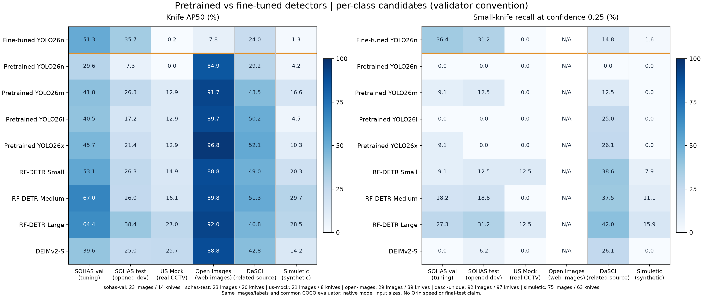

# 2026-11-04 기성 detector와 파인튜닝 모델의 다중 평가셋 비교

상태: PC13의 고정 개발 평가 범위 `VERIFIED`. 최종 detector D*·Orin 배포·실제 사건 성능은 미확정/미검증.

## 결론

**현재 파인튜닝 모델이 기성 모델보다 전반적으로 낫다는 근거는 없다.** 동일 YOLO26n의 학습 전후를 보면 SOHAS에서는 개선되지만, DaSCI·Open Images·합성 CCTV의 AP50은 낮아졌다. RF-DETR Large는 SOHAS opened test의 AP50에서 현재 모델을 소폭 넘고 다른 domain에서도 더 높은 점수를 얻었다. 그러나 conf.25의 SOHAS recall은 현재 모델35%, RF Large30%이고 실제 CCTV8개 중 RF Large도1개만 검출했다. 어느 모델도 현재 자료만으로 배포 충분성을 입증하지 못한다.

본 작업은 **9개 checkpoint × 동일6개 평가셋**, 총263images/241knife GT의54개 비교를 수행했다. 후처리 convention 차이도 확인해 **default predict와 per-class candidate 두 track의108개 결과**를 따로 보존했다. 신규 학습·test 기반 threshold 조정·모델 배포는 하지 않았다.

## 1. 연구 질문과 변경 이력

- Q1: 동일한 YOLO26n의 학습 전 weight와 현재 SOHAS fine-tuned weight를 비교할 때, 어느 domain에서 개선/저하되는가?
- Q2: 기성 checkpoint를 그대로 사용하는 대안보다 현재 fine-tuned checkpoint가 실제로 유리한가?
- Q3: 작은 knife와 실제 CCTV에서 차이가 유지되는가? 모델 confidence/postprocessing이 비교에 미치는 영향은 무엇인가?
- checkpoint·평가 image selection·고정 confidence/IoU는 첫 평가 전 freeze했다. 다만 **per-class candidate track은 default predict/validator의 차이를 발견한 뒤 추가한 사후 protocol sensitivity**다. 사전 등록 실험이라고 주장하지 않으며 default 결과를 숨기지 않는다.
- fine-tuned 모델은 기존 DEV-SOHAS137장 train의50epoch AdamW+scale.9 best.pt다. 당시 val로 선택된 checkpoint를 그대로 사용했다. 현재 비교 중 재학습·새 weight 선택·외부 source 학습 승인은 없다. 반복 학습 seed의 평균 개선을 검증하는 실험도 아니다.

## 2. 동일 평가셋과 독립성 경계

| 평가셋 | 이미지 | 칼 GT | small GT | 음성 이미지 | group 수 | 의미·한계 |
|---|---:|---:|---:|---:|---:|---|
| SOHAS val | 23 | 14 | 11 | 10 | 8 | 기존 학습 선택/tuning용. 최종 평가 아님 |
| SOHAS opened test | 23 | 20 | 16 | 3 | 7 | 11월4일 이미 공개한 개발 test. unseen 아님 |
| US Mock CCTV | 21 | 8 | 8 | 13 | 10 | 실제 CCTV지만 칼8개/positive sequence5개뿐 |
| Open Images | 29 | 39 | 0 | 0 | 29 | 일반 웹 이미지. small GT0, 음성0 |
| DaSCI related | 92 | 97 | 88 | 0 | 1 | 92장 전부 보호 자료와 같은 filename family; 독립성 주장 금지 |
| Simuletic synthetic | 75 | 63 | 63 | 12 | 1 | 합성 자료. 실제 CCTV 성능과 분리 |

- 전체 모델이 각 열의 **동일 image bytes·동일 source boxes·동일 image IDs**를 받는다. 다른 시험지의 점수를 직접 비교하지 않는다. dataset 간 값은 domain 차이를 설명하는 용도다. 합성/관련-source를 합친 pooled 점수로 최종 모델을 정하지 않는다.
- 외부4개 pack의337장 중 read-only DB snapshot에서 `ok`인218장을 확인했다. review payload/pack identity hash를 묶고, hash/decode/EXIF/box count를 검사했다. 보호된 DEV183장과 SHA-256·dHash64(distance≤4, aspect ratio .9–1.1, low-information 제외)를 비교해 DaSCI visual candidate1장을 제외했다. 최종 외부217장+SOHAS46장=263장이다.
- 불확실/문제/미검수119장은 사용하지 않았다. 빈 label만으로 음성으로 처리하지 않고, 기존 `ok` 판정의 knife 부재 확인이 있는 경우만 음성으로 사용했다. 웹 검수 판정·배정·이력·source label은 쓰거나 바꾸지 않았다.
- 모든 외부 이미지가 protected image bytes와 같지 않다는 것과, 모든 촬영 세션이 독립이라는 것은 다르다. DaSCI92장 전부가 protected SOHAS와 같은 보수적 filename family다. 관련-source 탐색 자료로만 쓴다.
- US Mock은 source sequence ID로 묶었다. 나머지의 filename/dHash group은 실제 camera/session 확인이 아니다. Simuletic도 filename 규칙으로1group이므로 독립 반복으로 계산하지 않는다. crop/flip/변형 중복과 사전학습 corpus(COCO·foundation-model data)의 overlap은 완전히 배제하지 못했다.
- 모든 source는 학술 개발 비교용이다. upstream notice 충돌·개별 이미지 권리·라벨 원 의미·최종 GT gate를 이번 실행으로 승인하지 않는다. raw 이미지/annotation/DB/checkpoint는 공개 Git에 넣지 않았다.
- 현재6개는 **여러 source/domain의 개발 평가셋**이며6개 독립 최종 test가 아니다. SOHAS val은 이미 tuning에 쓰였고 test23장도11월4일 열렸다. 외부 표본도 이번 비교로 공개됐으므로, 이후 이 자료를 보고 모델을 선택하면 새 독립 final holdout이 필요하다.

## 3. 모델과 통제 조건

| 모델 | 입력 | raw knife ID | checkpoint SHA-256 (앞12자) |
|---|---:|---:|---|
| Fine-tuned YOLO26n | 640 | 0 | `d8eff85efff8` |
| Pretrained YOLO26n | 640 | 43 | `9b09cc8bf347` |
| Pretrained YOLO26m | 640 | 43 | `401cea9ab23a` |
| Pretrained YOLO26l | 640 | 43 | `9fe3c544f2b1` |
| Pretrained YOLO26x | 640 | 43 | `9fdd44a31c50` |
| RF-DETR Small | 512 | 49 | `d81979a9213a` |
| RF-DETR Medium | 576 | 49 | `749ff6071828` |
| RF-DETR Large (2026) | 704 | 49 | `0f4e20e19a99` |
| DEIMv2-S | 640 | 43 | `fe545b150766` |

전체 hash·acquisition URL·source revision·protocol은 [protocol.json](protocol.json), 실제 model config/class map은 [artifact-index.json](artifact-index.json)에 보존한다. RF Large는 구형 large가 아니라 `rf-detr-large-2026.pth`/704 checkpoint다. RF Small/Medium/Large의 공식 MD5와 SHA-256을 확인했다. DEIMv2는 공식 Git `f005f50ce565e63f6c298feccb51901a98c3d035`, HF `cf0540f3f319bb8ecbe132624358a35a7beb86d5`를 고정했다.

- PC13 RTX3060 12GB, Windows11, Python3.12.4, torch2.6.0+cu124, torchvision0.21.0+cu124, Ultralytics8.4.152, RF-DETR1.11.2, pycocotools2.0.11, NumPy1.26.4. [benchmark 환경 목록](requirements-benchmark.txt).
- 격리 `.venv-evaluation-20261104`에서 실행하고 기존 `.venv-ml`의 torch 등을 읽어 재사용했다. 신규 dependency는 격리 환경에 설치했다. 기존 학습/검수 환경의 `pip check`도 정상이며 운영 서비스를 재시작하지 않았다. `.git/info/exclude`에는 실험 venv만 local ignore로 추가했다.
- 모델마다 별도 process, batch1, 실제 parameter dtype 모두 FP32, CUDA0, TF32 off, seed20261104, synthetic blank3회 warmup. 원본 file hash와 stored-pixel 크기를 확인하고 RGB로 변환했다. EXIF 방향1 이외는 제외한다.
- **모델 권장 native input/preprocessing을 유지**했다. YOLO640 square letterbox, RF512/576/704 native predict, DEIM640 squash resize+ImageNet normalization이다. 동일 해상도/전처리를 통제한 순수 architecture ablation이 아니라 기성 모델 package 비교다. class0/43/49를 추정으로 섞지 않고 모두 canonical `knife`로 변환했다. person 정확도는 이번 비교 대상이 아니다.
- DEIM HF safetensors에는 `decoder.up`와 `decoder.reg_scale` 두 `requires_grad=False` scalar가 생략돼 있었다. pinned source/설정의0.5와4.0만 확인해 복원하고 **그 뒤 전체 state를 strict=True로 로드**했다. 다른 학습 weight 누락은 허용하지 않는다. initializer의 'Training ... from scratch' 메시지는 모듈 초기화 출력이며 optimizer/backward/train 실행을 뜻하지 않는다.

## 4. 공통 평가기와 후처리 두 track

### 주 비교: per-class candidates (v3)

YOLO의 official validator와 같은 `multi_label=True` 후보 convention을 명시한 얇은 `DetectionPredictor` 확장을 사용했다. weight/head의 학습값은 바꾸지 않았고 one-to-many head/NMS IoU.7/max_det300을 유지했다. RF/DEIM은 공식 native postprocessor를 그대로 사용한다. class별 후보를 공통 canonical JSONL에 기록하고 **모든9개를 동일 pycocotools.COCOeval**로 평가했다.

### 운용 민감도: default predict (v2)

YOLO 일반 `predict`의 `multi_label=False`와 다른 모델의 native `predict`를 그대로 사용한 결과다. [default-predict-comparison.csv](default-predict-comparison.csv), [default aggregate](default-predict-aggregate.json)에54개를 별도로 보존한다. v3가 실제 배포 파이프라인에 이미 반영됐다는 뜻은 아니다. [후처리 민감도54행](postprocessing-sensitivity.csv)에서 두 track을 직접 대조할 수 있다. custom/RF/DEIM의30개 source-model 조합은 두 track의 prediction JSONL SHA가 완전히 동일하다.

이 구분이 필요한 이유는 한 anchor에서 다른 물체 score.9/knife score.8이라면, default predict는 최고 클래스만 남겨 knife를 없애지만 per-class 검증은 knife 후보도 평가하기 때문이다. 실제 source에서 validator `multi_label=True`/predict defaultFalse를 확인했고 synthetic regression test로 재현했다. 예를 들어 pretrained n의 SOHAS val AP50은 default0.00% → per-class29.59%다. **기성 모델에 불리한 후보 필터를 놓고 파인튜닝 개선을 과장하지 않도록 두 결과를 모두 남긴다.**

- AP50/AP50–95: 공통 COCO evaluator, confidence floor.001, IoU .50:.05:.95,101recall points, class knife, maxDets100, all-area. 각 모델 제공 API의 결과로 계산하며 source별 native validator의 AP interpolation은 섞지 않는다.
- P/R/F1/TP/FP/FN: 기존 bbox evaluator, **confidence≥.25·matching IoU≥.5**, 일대일 confidence-first 매칭. 중복 box는FP다. 공통 geometry clipping을 적용하고 비유한 값/누락 frame/ID 불일치를 오류로 중단한다. small=원본 GT bbox normalized area≤.02다.
- small이0개인 Open Images의 small recall은 **N/A**다. 이를0%로 적지 않았다. 예측0개의 precision도 undefined다. AP와 .25의 recall은 서로 다른 값이며 모델 간 score calibration도 같다고 가정하지 않는다.
- [paired bootstrap](comparison.csv)은 current custom을 reference로 한 Recall@.25 차이를2,000회 동일 group 재표집(seed20261104)해 기록한다. GT0 replicate는 수를 밝히고 제외, positive group<2인 DaSCI/Simuletic에는 CI를 만들지 않는다. 작은 proxy-group 기반 descriptive interval이며 통계적 우위/학습 반복 재현성/다중 비교 보정을 주장하지 않는다.
- 전1차 YOLO 비교의34.43%와 본35.69%를 성능 향상으로 해석하면 안 된다. **weight는 같고 AP evaluator가 native Ultralytics → 공통 COCO로 바뀌었다.** 기존 보고는 역사 기록으로 보존하고 cross-family 비교에는 아래 동일 protocol 표를 사용한다.

## 5. 주 비교 결과 — Knife AP50 (%)

| 모델 | SOHAS val | SOHAS opened test | US Mock CCTV | Open Images | DaSCI related | Simuletic synthetic |
|---|---:|---:|---:|---:|---:|---:|
| Fine-tuned YOLO26n | 51.29 | 35.69 | 0.20 | 7.85 | 24.03 | 1.30 |
| Pretrained YOLO26n | 29.59 | 7.26 | 0.00 | 84.90 | 29.16 | 4.24 |
| Pretrained YOLO26m | 41.76 | 26.27 | 12.87 | 91.68 | 43.54 | 16.64 |
| Pretrained YOLO26l | 40.47 | 17.17 | 12.87 | 89.73 | 50.21 | 4.46 |
| Pretrained YOLO26x | 45.71 | 21.36 | 12.87 | 96.76 | 52.07 | 10.29 |
| RF-DETR Small | 53.06 | 26.25 | 14.85 | 88.84 | 49.01 | 20.35 |
| RF-DETR Medium | 67.04 | 25.99 | 16.09 | 89.84 | 51.34 | 29.73 |
| RF-DETR Large (2026) | 64.40 | 38.41 | 26.97 | 91.97 | 46.76 | 28.55 |
| DEIMv2-S | 39.55 | 24.95 | 25.74 | 88.75 | 42.78 | 14.23 |



논문/보고서 편집용 [SVG](figures/detector-comparison.svg), [PDF](figures/detector-comparison.pdf)를 함께 저장했다. 표 원본은 [comparison.csv](comparison.csv), 전체 AP50–95/P/R/F1/counts/hash/paired interval은 [aggregate.json](aggregate.json)에 있다.

## 6. 동일 n의 파인튜닝 전후

| 평가셋 | 학습 전 n AP50 | 학습 후 n AP50 | 차이(pp) | 학습 전 → 후 Recall@.25 |
|---|---:|---:|---:|---|
| SOHAS val | 29.59 | 51.29 | +21.69 | 0.0% → 42.9% |
| SOHAS opened test | 7.26 | 35.69 | +28.43 | 0.0% → 35.0% |
| US Mock CCTV | 0.00 | 0.20 | +0.20 | 0.0% → 0.0% |
| Open Images | 84.90 | 7.85 | -77.05 | 53.8% → 7.7% |
| DaSCI related | 29.16 | 24.03 | -5.12 | 0.0% → 19.6% |
| Simuletic synthetic | 4.24 | 1.30 | -2.94 | 0.0% → 1.6% |

SOHAS에 대해서는 학습 효과가 관측되지만, 나머지 AP에서는 보편적 개선이 아니다. 특히 큰 일반 knife를 담은 Open Images에서는 학습 전84.90% → 학습 후7.85%로 저하됐다. **도메인 과적합/일반화 저하 또는 forgetting의 징후**로 해석할 수 있으나, 데이터 수·학습 전략·class head·라벨 차이 중 원인을 이번 checkpoint 비교만으로 분리하지는 못한다. DaSCI에서는 고정.25 recall이 올라가면서 AP는 내려가므로 한 threshold의 recall만 골라 학습 성공으로 주장하지 않는다.

## 7. 고정 confidence의 운용 지표와 실제 CCTV

아래 recall은 모두 주 비교 track의 conf.25 / IoU.5다.

| 모델 | SOHAS val | SOHAS opened test | US Mock CCTV | Open Images | DaSCI related | Simuletic synthetic |
|---|---:|---:|---:|---:|---:|---:|
| Fine-tuned YOLO26n | 42.86 | 35.00 | 0.00 | 7.69 | 19.59 | 1.59 |
| Pretrained YOLO26n | 0.00 | 0.00 | 0.00 | 53.85 | 0.00 | 0.00 |
| Pretrained YOLO26m | 21.43 | 10.00 | 0.00 | 79.49 | 17.53 | 0.00 |
| Pretrained YOLO26l | 14.29 | 0.00 | 0.00 | 79.49 | 27.84 | 0.00 |
| Pretrained YOLO26x | 21.43 | 5.00 | 0.00 | 84.62 | 30.93 | 0.00 |
| RF-DETR Small | 21.43 | 15.00 | 12.50 | 87.18 | 39.18 | 7.94 |
| RF-DETR Medium | 28.57 | 20.00 | 0.00 | 89.74 | 38.14 | 11.11 |
| RF-DETR Large (2026) | 42.86 | 30.00 | 12.50 | 87.18 | 46.39 | 15.87 |
| DEIMv2-S | 21.43 | 5.00 | 0.00 | 87.18 | 27.84 | 0.00 |

- SOHAS test: custom은TP7/FP4/FN13(Recall35.0%, Precision63.6%), RF Large는TP6/FP5/FN14(Recall30.0%, Precision54.5%). RF의 AP50 +2.72pp를 고정 threshold의 우위 또는 유의한 향상으로 바꾸지 않는다. paired recall CI도0을 포함한다.
- US Mock 실제 CCTV:8knife GT에 대해 custom은TP0/FP25, RF Small과Large는각TP1/FP0이다. AP50은 custom0.20%, RF Large26.97%, DEIM25.74%이지만, .25 recall의 최고도12.5%다. **실용 수준이라고 판단할 수 없다.** 전체 FP 중 음성 이미지에서 발생한 box와 음성 이미지 수는 CSV의 별도 열로 확인한다.
- Open Images는 small GT0/음성0이므로 이 높은 AP를 high-angle CCTV 성능 또는 hard-negative 경보 억제 근거로 쓰지 않는다.
- Simuletic은 합성이며 RF Medium/Large AP가 높아도 실제 도메인 전이를 입증하지 않는다. 전체 소스의 점수를 섞어 한 모델을 '최고'로 정하지 않는다.

## 8. 육안 sanity check와 미해결 GT 검수

저장된 예측만으로 custom/RF Large의 같은 US Mock 양성3장+Open Images3장 contact sheet를 만들고 확인했다. custom은 일부 CCTV 배경 영역과 일반 칼 장면에서 잘못된 box를 생성하고, RF는 큰 일반 knife에 더 잘 맞는 box를 내는 사례가 보였다. 이 검토는 **AI 진단이며 human GT 승인/오류율 추정이 아니다**. 원본 사진은 Git에 넣지 않았다.

Open Images `validation/19aaf40e64cdfb7b.jpg`는 교차한 도구 이미지에서 다른 knife의 누락 annotation 가능성이 보인다. [annotation-review-needed.csv](annotation-review-needed.csv)에 재확인 항목으로 남겼다. 사후로 라벨을 고치거나 유리한 이미지만 제외/재평가하지 않았다. 이후 사람이 adjudication하면 별도 dataset revision/run으로 이전 결과와 함께 보존해야 한다.

## 9. 논문에 재사용할 수 있는 서술과 남은 조건

> 기성 detector와 개발용 fine-tuned detector를 동일한6개 source/domain 평가셋(263images/241knife annotations)에서 비교하였다. 각 모델의 native 입력 규격을 유지하되 class mapping과 평가 이미지를 고정하고 공통 COCO evaluator를 적용하였다. YOLO의 default prediction과 validator의 후보 생성 차이를 분리하여 후처리 민감도를 함께 보고하였다. fine-tuned YOLO26n은 SOHAS 개발 test에서 학습 전 checkpoint보다 높은 AP50을 보였으나, 외부 domain에서 일관된 개선을 보이지 않았다. RF-DETR Large는 일부 domain에서 더 높은 AP를 보였지만 실제 CCTV 소표본의 고정 threshold recall도 낮아, 최종 배포 충분성은 입증되지 않았다.

이 문단은 **개발 checkpoint 비교/예비 실험**에 사용할 수 있다. '6개 독립 final test', 'fine-tuning의 보편적 유효성', '실시간 Orin 성능', '실제 사건 오경보 감소', '통계적으로 유의한 RF 우위'로 바꾸면 안 된다. 최종 연구용으로는 목표 카메라 촬영·독립 session holdout·일관된 수동 box/event GT·검수자 간 불일치 adjudication이 필요하다. B0~B3는 선택한 동일 D*에서 별도로 검증한다.

후속 우선순위는 **RF Large/Small을 강한 기성 기준선 후보로 유지 → Orin 메모리/전체 지연 확인 → target-domain 평가 자료 확정 → 그 기준선을 넘을 필요가 있는 경우에만 추가 fine-tuning 비교**다. 현재 custom을 최종 D*로 승격하지 않으며 새 source를 자동 학습 승인하지 않는다.

## 10. 재현·검증·원시 위치

- canonical code base `867d7d169376aab6290ae9f07b94d8bf25cbff4f` + 이 보고와 함께 commit되는 실험 도구다. PC13 working checkout의 git_commit은`cf67450`으로 수집되지만, 실제 실행은 별도 source overlay였다. 이를 최신 main 배포 기록으로 오인하지 않는다. [실행 source hash/검증](verification.json)의6개 파일 SHA가 commit 대상과 같음을 확인했다.
- suite SHA-256 `e74e6f8d6dd7864cf9b1e14ed1aa3fd25ac7567f4028ed5f2354fed04e3fa67e`; primary model protocol SHA-256 `6ce18b366f78d561d0eeb7b177e09e0d041804b06323a712c6288f2a6bd6395b`. 공개 [selection.csv](selection.csv)는 image hashes/groups/counts를 제공하며 source truth/원본 boxes는 PC13에 보관한다. 정답 파일 hash는 CSV/aggregate에 있다.
- PC13 frozen data/protocol: `C:/Class6/edge-threat-response/data/work/multi-model-20261104/suite-v1/`, `models.json`(default), `models-val-candidates.json`(per-class), `downloads.json`, `pip-install-report.json`, `pip-freeze.txt`.
- default 결과: PC13 `runs/pretrained-vs-finetuned-20261104-v2/`; primary 결과: `runs/pretrained-vs-finetuned-20261104-v3/`. 각 case의6개 source별 `predictions.jsonl`, `matches.jsonl`, `summary.json`, top-level 완료 marker·실효 model config·class map·weight/truth/prediction hash를 보존한다. v2/v3 모두9개 child exit0이며 같은9개/6개를 완전 집계했다.
- v1은8개 완료 후 DEIM scalar 누락으로 중단됐다. 보완 후 v2 전체 재실행, 후처리 차이 발견 후 v3 전체 재실행을 각각 보존했다. 성공한 모델만 골라 최종 table을 만든 것이 아니다.
- suite input(config/manifest/approval/split lists/train·val·test image/label/pack evidence/CSV)과 모든 checkpoint를 전후 검사했고, DEIM extra config/vendor source도 최종 일치했다. site DB는 mode=ro와 in-memory backup만 사용했다. 현재 운영의 DB hash가 사용자의 진행 중 검수와 무관하게 고정됐다고 주장하지 않는다.
- 로컬 UTF-84 tests 통과/optional3 tests skip, 두 CLI의 flag 없는 파일 접근 전 거부 guard·compileall 통과. PC13 격리 환경 관련7 tests, 최종 전체**160 tests17.396s**·src/tools/tests compileall 통과, 기존 ML 환경 pip check 정상이다. QA의 HEIF 입력 검사에서 pi-heif1.4.0이 실험 venv에 추가 설치됐으며 benchmark 당시 lock과 QA 후 환경을 구분한다. 추가 dependency를 기존 운영 venv에 설치한 것이 아니다.
- 현재 commit 대상 driver의 default 경로를 pretrained n으로 한 번 더 실행해6개 source의 JSONL SHA와 AP가 v2와 완전히 같음을 확인했다. [재현 확인](default-reproduction-verification.json). 이 재실행은 `YOLO_AUTOINSTALL=false`였다.
- 실제 image inference는 GPU FP32에서 두 track 각각2,367개 image-model 조합을 완료했다. source별 `per_image_api_ms_PC13_not_Orin_benchmark`는 참고 원시 계측일 뿐, Orin FPS/카메라 실시간 benchmark로 제시하지 않는다. camera/GPIO·TensorRT·Orin model fit는 이 작업에서 검증하지 않았다.

PC13에 남아 있는 frozen 입력을 사용한 재실행 예시(항상 새 output):

```powershell
$env:PYTHONUTF8='1'
$env:YOLO_AUTOINSTALL='false'
$env:PYTHONPATH='src'
.venv-evaluation-20261104/Scripts/python.exe tools/run_detector_comparison.py `
  --suite data/work/multi-model-20261104/suite-v1/suite.json `
  --models data/work/multi-model-20261104/models-val-candidates.json `
  --case rf-large-704 --output runs/NEW-RUN-ID/rf-large-704 `
  --authorize-development-comparison
```

새 suite 준비는 `tools/prepare_detector_comparison.py --root <repo> --output <fresh> --authorize-development-comparison`으로 수행한다. DB snapshot 시점이 달라지면 선택도 달라지므로 기존 frozen suite를 덮어쓰지 않는다. 전체9개 완료 run의 집계는 `tools/summarize_detector_comparison.py`, 그림은 `tools/plot_detector_comparison.py`로 재생성한다.

## 11. 외부 구현 근거

- [Ultralytics YOLO26](https://docs.ultralytics.com/models/yolo26/) — checkpoint·one-to-many/e2e 구분.
- [RF-DETR 공식 repository](https://github.com/roboflow/rf-detr) / [공식 export](https://rfdetr.roboflow.com/latest/exports/) — 기성 checkpoint·native API·배포 경로. 현재 모델의 Orin 동작 증거를 대신하지 않는다.
- [DEIMv2 공식 repository](https://github.com/Intellindust-AI-Lab/DEIMv2) — pinned source·HF config/state·ViT 전처리.
- [COCO API](https://github.com/cocodataset/cocoapi) — 공통 evaluator. 실제 사용 package version은2.0.11이다.
