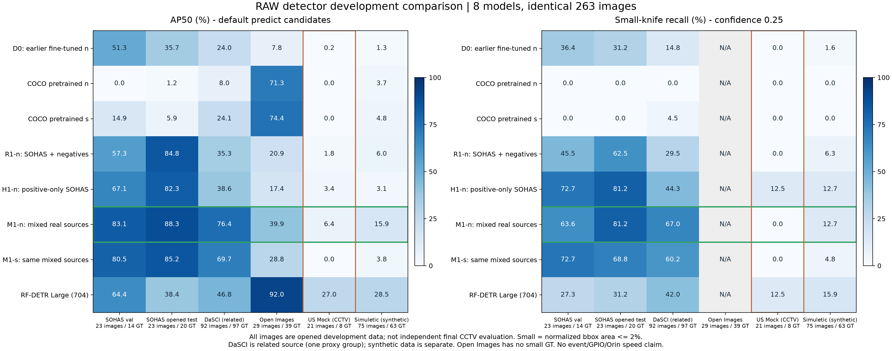

# RAW 학습 결과와 다음 모델·학습 방향

**권장 주력 후보는 YOLO26n + M1 실사 혼합 데이터다.** 640 기준선을 유지하고, 960은 같은 weight의 추론 비교 후보로 남긴다. 다음 학습은 n 구조를 고정한 데이터 보강·목표 CCTV 적응에 집중한다. 최종 D* 동결·실제 사건 성능 확정은 아직 하지 않는다.

2026-11-06에 네 모델의 학습과 8개 모델 × 6개 개발셋의 공통 평가를 확인했다. AP와 실제 predict 방식을 분리했고, 640에서 학습한 M1-n/s weight의 960 추론도 추가 비교했다. 모든 자료는 이미 평가에 사용한 개발 자료다. 독립 final CCTV test는 별도로 확보해야 한다.

가장 큰 남은 문제는 **실제 CCTV 표본에서 M1-n/s가 knife 정답 8개를 confidence=.25에서 검출하지 못한 것**이다. 960 추론에서도 같았다. 따라서 다음 단계의 우선순위는 목표 CCTV 데이터 확보와 오류 분석이다.

## 1. 학습 완료

| Recipe | 완료(KST) | 소요 시간 | Optimizer updates |
|---|---|---:|---:|
| RAW-R1-n | 11/05 16:28 | 4.93h | 35,600 |
| RAW-H1-n | 11/05 21:08 | 4.66h | 35,600 |
| RAW-M1-n | 11/06 01:34 | 4.42h | 35,600 |
| RAW-M1-s | 11/06 08:27 | 6.88h | 35,600 |

네 조건은 각각 50 epoch, 11,392 draws/epoch, batch=nbs=16, FP32, AdamW/lr=.001, scale=.9, seed=20261004다. 실제 loader의 712 batches, accumulate=1, 35,600 updates를 확인했다. R1/H1/M1의 고유 train 이미지는 각각 4,982/1,561/11,378장으로 반복 노출량이 다르다. R1↔H1은 음성 포함 여부와 양성 노출량이 함께 달라지는 **recipe 비교**다. 차이를 음성 유무만의 인과효과로 해석하지 않는다.

## 2. 실제 predict 방식의 공통 결과

다음은 AP50(%)다. 출처별 결과를 따로 보고하며, 서로 다른 촬영 환경을 하나의 평균 점수로 묶지 않는다. YOLO는 640/FP32, RF-Large는 자체 입력 규격인 704를 사용했다. 두 모델 계열은 전처리와 입력 크기도 다르므로 준비된 시스템의 비교로 해석한다.

초록 선은 주력 후보 M1-n, 주황 선은 실제 CCTV 표본이다. [SVG](figures/default-predict-comparison.svg)와 [PDF](figures/default-predict-comparison.pdf)도 함께 보관했다.

| Candidate | SOHAS dev test (23장) | DaSCI related (92장) | Open Images (29장) | US CCTV (21장) | Synthetic (75장) |
|---|---:|---:|---:|---:|---:|
| 기존 D0 n | 35.7 | 24.0 | 7.8 | 0.2 | 1.3 |
| 기성 COCO n | 1.2 | 8.0 | 71.3 | 0.0 | 3.7 |
| 기성 COCO s | 5.9 | 24.1 | 74.4 | 0.0 | 4.8 |
| R1-n: SOHAS+원주석 음성 | 84.8 | 35.3 | 20.9 | 1.8 | 6.0 |
| H1-n: SOHAS 양성만 | 82.3 | 38.6 | 17.4 | 3.4 | 3.1 |
| M1-n: 실사 혼합 | 88.3 | 76.4 | 39.9 | 6.4 | 15.9 |
| M1-s: 같은 실사 혼합 | 85.2 | 69.7 | 28.8 | 0.0 | 3.8 |
| RF-DETR Large | 38.4 | 46.8 | 92.0 | 27.0 | 28.5 |

SOHAS 개발 test 23장에는 knife 정답 20개가 있다. 아래 지표는 confidence=.25, IoU=.5로 계산했다. Small은 원본 이미지 면적의 2% 이하인 bbox다. FP는 잘못 검출한 이미지 bbox 수이며 시간당 사건 오경보와 구분한다.

| Candidate | Precision % | Recall % | Small recall % (16GT) | TP / FP / FN |
|---|---:|---:|---:|---|
| 기존 D0 n | 63.6 | 35.0 | 31.2 | 7 / 4 / 13 |
| 기성 COCO n | — | 0.0 | 0.0 | 0 / 0 / 20 |
| 기성 COCO s | — | 0.0 | 0.0 | 0 / 0 / 20 |
| R1-n: SOHAS+원주석 음성 | 100.0 | 70.0 | 62.5 | 14 / 0 / 6 |
| H1-n: SOHAS 양성만 | 63.0 | 85.0 | 81.2 | 17 / 10 / 3 |
| M1-n: 실사 혼합 | 94.1 | 80.0 | 81.2 | 16 / 1 / 4 |
| M1-s: 같은 실사 혼합 | 93.3 | 70.0 | 68.8 | 14 / 1 / 6 |
| RF-DETR Large | 54.5 | 30.0 | 31.2 | 6 / 5 / 14 |

M1-n의 SOHAS AP50은 기존 D0의 35.7%에서 88.3%로, recall은 35%에서 80%로 개선됐다. DaSCI에서도 M1-n은 AP50 76.4%, recall 68.0%를 기록했다. H1은 SOHAS recall이 85%지만 FP가 10개이고, DaSCI의 FP는 83개다. 음성이 포함된 recipe와 다른 검출률·오탐의 균형을 보인다.

**실제 CCTV 검출은 여전히 과제다.** US Mock의 knife 정답 8개에 대해 M1-n/s는 confidence=.25에서 0개, RF-Large는 1개를 검출했다. Open Images에서는 RF-Large의 AP50 91.97%가 M1-n의 39.87%보다 높다. M1-n의 개선 범위와 한계를 함께 봐야 한다. DaSCI 92장은 하나의 proxy group이며 보호 자료와 filename family가 연관돼, 독립적인 일반화 증거로 삼기 어렵다.

## 3. 재학습 없는 960 입력 진단

다음 네 조건은 모두 640으로 학습한 기존 weight다. 모델별로 같은 checkpoint SHA를 유지하고 추론 입력 크기만 바꿨다. 960으로 다시 학습한 결과와 구분한다.

| Model / inference | SOHAS AP50 % | SOHAS recall % | SOHAS small R % | DaSCI AP50 % | DaSCI small R % | US CCTV TP/8 |
|---|---:|---:|---:|---:|---:|---:|
| raw-m1-n-640 | 88.3 | 80.0 | 81.2 | 76.4 | 67.0 | 0/8 |
| raw-m1-n-960 | 87.4 | 85.0 | 87.5 | 85.9 | 80.7 | 0/8 |
| raw-m1-s-640 | 85.2 | 70.0 | 68.8 | 69.7 | 60.2 | 0/8 |
| raw-m1-s-960 | 83.1 | 80.0 | 81.2 | 77.1 | 72.7 | 0/8 |

M1-n의 960 추론은 SOHAS의 small TP가 13→14/16, DaSCI가 59→71/88로 증가했다. US CCTV는 계속 0/8이고 Open Images AP50은 39.9→29.0%로 감소했다. 목표 CCTV 데이터와 Orin의 960 처리 지연·메모리를 확인한 뒤 운영 해상도를 정한다. 현재 Orin의 실시간 검증은 R1-n/640으로 수행했으므로 새 M1-n/960에서도 검증을 다시 해야 한다.

## 4. 다음 학습 방향 — 권장안(PROPOSAL)

1. **모델 축 고정:** M1-n을 후속 실험의 주력 후보로 삼는다. R1-n은 SOHAS 기준선, M1-s는 대조군, RF-Large는 강한 기성 기준선으로 보존한다. 단일 seed 결과이므로 n이 항상 우수하다고 주장하지 않는다.
2. **다음 데이터 비교:** 기존 M1과 보강 M2를 같은 n/640 및 optimizer update 예산에서 비교한다. M2는 별도 Open Images train 594장 중 중복·보호 그룹을 제거한 자료를 후보로 한다. 공개 자료 보강과 이후의 자체 CCTV 적응은 다른 run으로 분리한다. RAW 학습의 사람 검수 대기는 필수 조건이 아니며, 클래스·라벨·무결성·출처·분할 기술 검사는 유지한다.
3. **목표 환경 우선:** 약 3m 설치 환경에서 사람과 모형 칼, 가림, 전화기·지갑·빈손·책상 위 칼 등을 촬영하고 bbox를 만든다. Train/tuning/final과 동시 촬영한 스마트폰 원본을 세션 단위로 분리한다. 새 영상의 정답 생성은 기존 이미지의 품질 검수와 별개로 필요하다.
4. **해상도는 추론 후보부터:** 기존 M1-n의 640/960을 같은 CCTV tuning 영상에서 비교한다. 960의 이득과 Orin 비용이 확인된 경우에만 960 학습을 추가한다. Batch/accumulate가 바뀌면 통제 조건과 실제 update 예산을 다시 확인한다.
5. **Threshold와 HOI:** val 23장의 F2 threshold는 진단용이며 자동 적용하지 않는다. 실제 CCTV tuning으로 보정한다. H1의 높은 recall·FP와 M1-s의 일부 val/F2 이득도 보존한다. HOI에는 명시적인 Holding/Not Holding 관계 정답을 별도로 수집한다.
6. **Orin 교체는 별도 검증:** 기존 R1 시연 weight를 보존하고 새 M1-n SHA를 등록해 실제 카메라/GPU smoke를 수행한다. 현재 Orin은 원격 오프라인으로 교체를 실행하지 않았다. PC14는 Tailscale과 SSH 응답만 확인했으며 키 등록·Windows 사용자명·GPU 사양 확인 후 작업을 배정한다.

## 5. 평가 자료와 한계

| Dataset | Images | Knife GT | Group 근거 |
|---|---:|---:|---|
| dasci-unique | 92 | 97 | 1 groups; filename/dHash proxies |
| open-images | 29 | 39 | 29 groups; filename/dHash proxies |
| simuletic | 75 | 63 | 1 groups; filename/dHash proxies |
| sohas-test | 23 | 20 | 7 groups; frozen full-source filename/dHash proxies |
| sohas-val | 23 | 14 | 8 groups; frozen full-source filename/dHash proxies |
| us-mock | 21 | 8 | 10 groups; source sequence |

총 263장, knife 정답 241개다. SOHAS 23/23장은 이미 열린 개발 자료이고, DaSCI는 관련 출처, Simuletic은 합성 데이터다. Open Images에는 small 정답이 없고 US Mock은 knife 정답 8개의 소표본이다. 원본 학습 주석의 사람 검수가 완료됐다고 표기하지 않는다. 사건 정답이 없는 이미지 평가로 B0~B4의 사건 precision/recall, 시간당 오경보, 실제 경보 지연을 주장하지 않는다.

M1의 '실사 혼합'은 SOHAS/Dangerous VOC/Catargiu를 실사 보강에 사용하려는 recipe 이름이다. 개별 학습 이미지가 모두 실사이거나 목표 CCTV 시점이라고 검증한 것은 아니다.

Val 23장의 F2에서는 M1-s/640이 M1-n/640보다 높은 조건도 있다(각 0.811/0.746). 최적 threshold 하나나 개별 출처만으로 최종 모델을 확정하지 않는다. 모델과 파라미터를 고정한 뒤 새로운 독립 CCTV final session을 평가한다.

## 6. 복구·재현·검증

- 학습 source는 cd60f3b, queue SHA는 `983430cce0dd12cd6b0c36092b2e439a76a24945f761c56c1a27e377b923e030`이다. 네 invocations의 실제 35,600 updates와 checkpoint hash를 다시 확인했다.
- AP 추론 8모델×6개는 완료돼 있었고, 보고 메타데이터 `policy` 누락으로 집계만 실패했다. 수정 e295586은 누락을 명시하며 기존 hash·지표 재계산 검사를 유지한다. 원본 AP/state/protocol/result 162개 파일의 hash가 보존됐다. 재학습·검수 DB·원본 split 변경은 없다.
- AP는 기존 예측을 다시 집계했고 predict는 새 출력에 실행했다. AP의 per-class candidates와 실제 predict의 single-label candidates를 분리했다. 기성 YOLO의 AP가 두 방식에서 달라지므로 각 방식의 최고값을 섞지 않는다.
- 복구 source e295586, `.venv-evaluation-20261104`, RTX3060 12GB에서 전체 186 tests가 22.970초, skip 없이 통과했다. 새 회귀는 메타데이터 유무·원본 hash 보존·변조 거부를 검사한다.
- PC13의 `runs/raw-followup-20261106-recovery-v1`과 `runs/raw-resolution-20261106-v1`에 원시 예측·로그·case/config/checkpoint/protocol/truth hashes를 보관했다. 이 보고서 폴더에는 집계·학습 CSV와 출처 추적 자료만 내보냈다. 이미지·weight·비밀정보는 Git에 넣지 않았다.

Artifacts: [predict CSV](predict/aggregate/comparison.csv), [AP CSV](ap/aggregate/comparison.csv), [resolution CSV](resolution/comparison.csv), [recovery state](state.json), [training summary](training-summary.json), [input preservation](preserved-input-hashes.json). 새 학습은 아직 시작하지 않았다.
