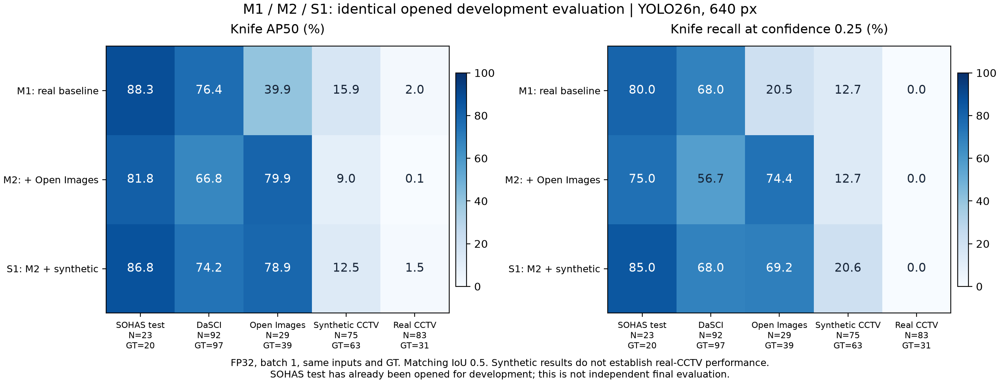

# S1 합성 보강 대 M1·M2 — 2026-11-08

**S1은 일부 공개·합성 자료에서 M2보다 나아졌지만 실제 CCTV 검출 문제는 해결하지 못했다.** 50 epoch·37,700 optimizer update와 같은 7개 개발셋 평가가 모두 완료됐다. confidence 0.25에서 확대 CCTV의 칼31개를 세 모델 모두 검출하지 못했다. S1을 최종 D*로 자동 채택하지 않고, 실제 촬영/T1 적응 학습을 다음 우선 작업으로 유지한다.

## 실행과 데이터

- PC13 RTX3060 12GB, 기존 Python3.12.4/torch2.6.0+cu124/Ultralytics8.4.152. 학습 source `ebc7f20924aae8fedf66d227979e6dea5ad266d5`. 학습 종료 11/08 **20:21 KST**, AP/predict·threshold·비교표 생성 종료 **20:23 KST**. [완료 state](evaluation-state.json), [학습 invocation](training-invocation.json).
- S1 = M2 실사11,884 + ATM116 + 신규 CCTV60 = train12,060. 추가176장 중 양성161/음성15, knife163개다. frozen val/test 각1,423장과 M2 실사 identity·순서·이미지/라벨 hash를 유지했다. 원본 라벨을 이용한 RAW 개발 실험이며 전수 사람검수를 완료했다는 뜻은 아니다. [source 준비·보호 검사](../../training/s1-synthetic-2026-11-08/report.md).
- M1·M2와 같은 COCO YOLO26n 초기 weight, 640, 50 epochs, FP32, batch16, seed20261004, optimizer/증강 설정이다. M2 best.pt에서 이어서 학습하지 않았다. 실제 loader12,064 draws/754 batches/accumulate1이며 37,700 updates를 확인했다. M1은35,600, M2는37,150 updates다. update 수가 같지 않으므로 순수 데이터 인과 효과가 아닌 전체 recipe 비교다.
- 비교는 네 checkpoint(D0/M1/M2/S1)×7개 개발셋×predict/AP 두 경로, 총56개 partition이다. 각 모델346 image entries/고유325images다. US21은 US83의 부분집합이므로 합산하지 않는다. source 간 성능도 임의로 pooling하지 않는다.
- 평가: 동일 PC13/FP32/batch1/640 square letterbox/rect=False/TF32=False, NMS IoU.7, candidate floor.001. 고정 confidence.25, matching IoU.5, small은 normalized area≤.02다. AP50/AP50–95는 공통 COCO 평가기를 사용한다. [predict 프로토콜](predict-models.json), [별도 AP 프로토콜](ap-models.json).
- 각 run의 기존 native validation에서 선택한 best.pt를 사용했다. 학습의 raw val/test 각1,423장과 아래 열린 개발 평가셋은 구분한다. 실제 Orin/사건/B0~B4/최종 독립 CCTV 성능을 측정한 실험이 아니다.

## 핵심 Recall 비교

confidence 0.25, matching IoU 0.5. FP는 잘못 검출한 bbox 수이며 사건 경보 수가 아니다.

| 모델 | SOHAS test | DaSCI | Open Images | 합성 CCTV | 실제 CCTV TP/31 | 실제 CCTV FP |
|---|---:|---:|---:|---:|---:|---:|
| M1 | 80.0% | 68.0% | 20.5% | 12.7% | 0/31 | 2 |
| M2 | 75.0% | 56.7% | 74.4% | 12.7% | 0/31 | 7 |
| S1 | 85.0% | 68.0% | 69.2% | 20.6% | 0/31 | 4 |

- SOHAS test: S1은17/20 검출로 M2의15/20, M1의16/20보다 높다. 대신 FP는2개로 두 기준의1개보다 많다. 1~2개 객체 차이이므로 일반적인 우월성을 주장하지 않는다.
- DaSCI: S1은66/97로 M2의55/97보다 높지만 M1과 같다. S1의 FP30개는 M1의23개보다 많고 small TP58/88은 M1의59/88보다 하나 적다. 관련 source·그룹 한계를 유지한다.
- Open Images: S1은27/39로 M2의29/39보다 적게 검출하고 FP는14→11로 줄었다. Precision은67.4→71.1%, F1은70.7→70.1%다. 손익이 서로 달라 명확한 우위가 아니다.
- 합성 CCTV: S1은13/63으로 M1/M2의8/63보다5개 더 검출했다. 그러나 FP54개가 남고 Recall20.6%·F1 20.0%라 충분한 detector 성능이라고 보기 어렵다. AP50은 S1 12.5%, M1 15.9%, M2 9.0%로 Recall과 순위가 다르다.
- 실제 CCTV 확대83장: 세 모델 모두0/31이다. S1 FP4는 M2의7보다 적지만 M1의2보다 많다. 합성에서의 개선이 이 실사 CCTV에 충분히 전이됐다는 근거는 없다.

## 전체 Precision·Recall·F1·AP50

아래 값은 predict 경로다. `—`는 예측이 없어 Precision이 정의되지 않는 경우다. AP50–95와 small/negative 지표·D0는 [전체 CSV](predict-comparison.csv)에 있으며 [AP 경로](ap-comparison.csv)를 따로 보존했다.

| 평가셋 | 모델 | GT | AP50 | Precision | Recall | F1 | TP | FP | FN |
|---|---|---:|---:|---:|---:|---:|---:|---:|---:|
| SOHAS val | M1 | 14 | 83.1% | 83.3% | 71.4% | 76.9% | 10 | 2 | 4 |
| SOHAS val | M2 | 14 | 80.0% | 83.3% | 71.4% | 76.9% | 10 | 2 | 4 |
| SOHAS val | S1 | 14 | 77.6% | 71.4% | 71.4% | 71.4% | 10 | 4 | 4 |
| SOHAS test | M1 | 20 | 88.3% | 94.1% | 80.0% | 86.5% | 16 | 1 | 4 |
| SOHAS test | M2 | 20 | 81.8% | 93.8% | 75.0% | 83.3% | 15 | 1 | 5 |
| SOHAS test | S1 | 20 | 86.8% | 89.5% | 85.0% | 87.2% | 17 | 2 | 3 |
| DaSCI | M1 | 97 | 76.4% | 74.2% | 68.0% | 71.0% | 66 | 23 | 31 |
| DaSCI | M2 | 97 | 66.8% | 64.0% | 56.7% | 60.1% | 55 | 31 | 42 |
| DaSCI | S1 | 97 | 74.2% | 68.8% | 68.0% | 68.4% | 66 | 30 | 31 |
| Open Images | M1 | 39 | 39.9% | 30.8% | 20.5% | 24.6% | 8 | 18 | 31 |
| Open Images | M2 | 39 | 79.9% | 67.4% | 74.4% | 70.7% | 29 | 14 | 10 |
| Open Images | S1 | 39 | 78.9% | 71.1% | 69.2% | 70.1% | 27 | 11 | 12 |
| 합성 CCTV | M1 | 63 | 15.9% | 19.0% | 12.7% | 15.2% | 8 | 34 | 55 |
| 합성 CCTV | M2 | 63 | 9.0% | 11.8% | 12.7% | 12.2% | 8 | 60 | 55 |
| 합성 CCTV | S1 | 63 | 12.5% | 19.4% | 20.6% | 20.0% | 13 | 54 | 50 |
| CCTV 기존21장 | M1 | 8 | 6.4% | — | 0.0% | 0.0% | 0 | 0 | 8 |
| CCTV 기존21장 | M2 | 8 | 0.0% | 0.0% | 0.0% | 0.0% | 0 | 1 | 8 |
| CCTV 기존21장 | S1 | 8 | 1.4% | 0.0% | 0.0% | 0.0% | 0 | 2 | 8 |
| CCTV 확대83장 | M1 | 31 | 2.0% | 0.0% | 0.0% | 0.0% | 0 | 2 | 31 |
| CCTV 확대83장 | M2 | 31 | 0.1% | 0.0% | 0.0% | 0.0% | 0 | 7 | 31 |
| CCTV 확대83장 | S1 | 31 | 1.5% | 0.0% | 0.0% | 0.0% | 0 | 4 | 31 |

## 실제 CCTV confidence 진단

확대83장/knife31개. 52장은 knife GT가 없는 이미지다. 전체 FP와 음성 이미지에서의 FP 발생은 서로 다른 지표다. confidence를 사후에 선택해 배포값으로 바꾸지 않았다.

| Confidence | 모델 | Recall | Precision | F1 | TP | FP | FP 발생 음성 이미지/52 |
|---:|---|---:|---:|---:|---:|---:|---:|
| 0.1 | M1 | 9.7% | 17.6% | 12.5% | 3 | 14 | 2/52 |
| 0.1 | M2 | 0.0% | 0.0% | 0.0% | 0 | 24 | 9/52 |
| 0.1 | S1 | 6.5% | 9.5% | 7.7% | 2 | 19 | 7/52 |
| 0.25 | M1 | 0.0% | 0.0% | 0.0% | 0 | 2 | 0/52 |
| 0.25 | M2 | 0.0% | 0.0% | 0.0% | 0 | 7 | 2/52 |
| 0.25 | S1 | 0.0% | 0.0% | 0.0% | 0 | 4 | 1/52 |
| 0.5 | M1 | 0.0% | 0.0% | 0.0% | 0 | 1 | 0/52 |
| 0.5 | M2 | 0.0% | 0.0% | 0.0% | 0 | 1 | 0/52 |
| 0.5 | S1 | 0.0% | 0.0% | 0.0% | 0 | 1 | 0/52 |

0.10에서도 S1은2/31 TP·19 FP다. M1은3/31·14 FP, M2는0/31·24 FP다. threshold 조정만으로 실용적 검출을 확보했다고 볼 수 없다. 전체 .10~.50/.05 step 및 .001/.05 진단은 [confidence CSV](predict-thresholds.csv)에 있다.

## 검증과 불확실성

- queue/invocation `passed`, 실제37,700 update, results.csv50행, best/last/CSV artifact SHA를 대조했다. best.pt SHA는 `2ac5c5bb112886c1e4e7c7e5a3d68579f9ad3ac029d71d86a5397ae4bad2e358`다. 학습 CSV의 누적시간은16,974.6초(약4시간43분)이며 wrapper 전체시간과 구분한다.
- 원 suite·GT·고유325개 이미지·모든 checkpoint/protocol/prediction SHA를 확인했다. 56개 partition의 fixed metrics를 원시 예측에서 재계산하고 S1의14개 partition AP50/AP50–95를 공통 COCO 평가기로 다시 계산해 일치했다. 각 track28개 fixed/308개 threshold행과 .25 counts 일치를 확인했다. [검증](verification.json).
- 기존 D0/M1/M2의21 partition×2경로=42개 결과가 이전 평가의 fixed/AP50을 재현했다. [predict 기준 재현](predict-reference-reproduction.json), [AP 기준 재현](ap-reference-reproduction.json).
- paired group bootstrap(2,000회)은 [predict 결과](predict-paired-vs-m1-m2.json)에 있다. S1−M2 Open Images Recall 차이 −5.1pp의 95% 구간은 약[−13.9,+5.4]pp로0을 포함한다. SOHAS test 차이 +10pp의 구간도0을 포함한다. DaSCI와 합성 자료는 각각 positive proxy group이1개라 신뢰구간을 추정하지 않는다.
- 합성 추가는 전체 train의 약1.46%이며 oversampling하지 않았다. 단일 seed·고정된 한 데이터 구성의 관측이다. 이번 결과로 모든 합성 데이터의 효과 부재나 원거리 실패의 단일 원인을 입증하지 않는다. 서로 다른 제작사/실사 카메라/실제 session 독립성과 annotation 완전성의 한계도 유지한다.
- 검수 사이트·DB·배정·원본·이전 학습/평가·분할·운영 threshold·Orin은 변경하지 않았다. 새 학습은 시작하지 않았다. 준비 당시의210 tests와 별도 평가12 tests는 이전 실행 검증이며, 이번에는 바뀌지 않은 평가 코드를 이용해 결과와 artifact를 재검산했다.

## 권장 방향 — PROPOSAL

S1을 비교 후보로 보존하되 D*로 확정하거나 Orin 운영 모델을 자동 교체하지 않는다. M1/M2/S1 어느 것도 이 실제 CCTV 평가를 통과한 detector라고 할 수 없다. 다음 주 P430·스마트폰 촬영, session별 train/tuning/final 분리, bbox·Holding·event GT 확보 후 T1 적응을 우선한다. S1과 기존 기준 중 어떤 초기 모델을 쓸지는 목표 CCTV tuning 자료로 판단하며 최종 session은 모델 선택에 쓰지 않는다.

공개 데이터 추가·해상도·증강·seed·이번 합성 결과를 모두 보존하되, 같은 공개 개발셋 점수만 보고 모델을 확정하지 않는다. Orin 지연/메모리·GPIO·실제 HOI·독립 B0~B4는 별도 미완료 항목이다.

## 재현·원시 파일

- 실행 source/worktree: `ebc7f20`, PC13 `C:\Class6\etr-worktrees\s1-20261108-run`
- 학습: `C:\Class6\edge-threat-response\runs\training\s1-synthetic-20261108-v2-raw-s1-n`
- 비교: `C:\Class6\edge-threat-response\runs\s1-comparison-20261108-v1`
- [자동 비교 driver](../../training/s1-synthetic-2026-11-08/followup-worker.py), [결과 재검산](verify-driver.py), [그림 생성](plot-driver.py).
- 그림: [SVG](m1-m2-s1.svg), [PDF](m1-m2-s1.pdf), [환경](plot-environment.json). 원시 이미지·weight·상세 예측은 PC13에 유지하고 Git에는 표·검증·driver·그림만 올린다.
- 학습·기준 checkpoint/설정/manifest SHA는 invocation과 models.json, 근거 파일 SHA는 evidence-index.json에 기록한다. Git commit은 본 저장소 이력으로 추적한다.
