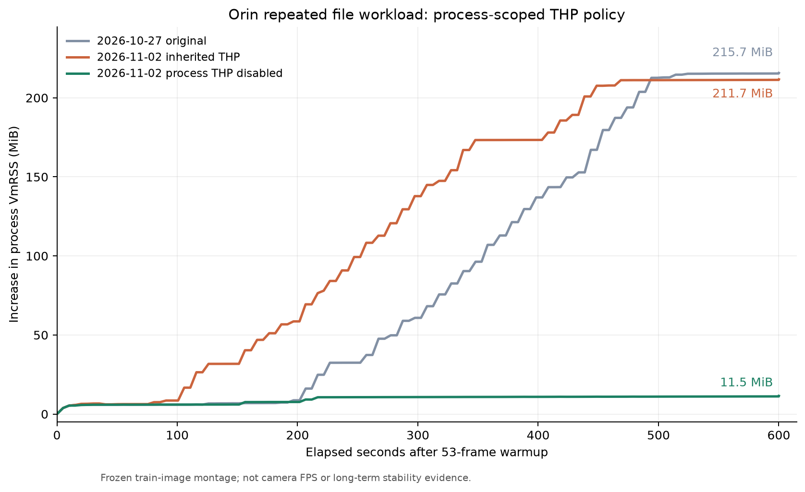

# Orin 메모리 증가 원인 분석 — 2026-11-02

**해당 workload의 지배적인 원인은 THP 자동 병합에 따른 resident memory 팽창이었다.** 오린 추론 worker에만 THP를 비활성화한 결과, 같은600초의 추가 VmRSS 증가가 **211.664→11.453MiB(94.59% 감소)**로 줄었고 공통7,291frame의 탐지·판단은 일치했다. 전역 kernel 설정은 유지했다.

대상은 [2026-10-27 파일 반복 검사](../orin-readiness-2026-10-27/report.md)의 process VmRSS +215.70MiB다. 이 수치만으로 Python 메모리 누수나 CUDA 누수라고 단정하지 않고, 실제 카메라/GPIO 없이 같은 frozen 모델·시험 영상으로 재현해 원인을 분리했다.

## 범위·판정 기준

- 변경 대상은 메모리 문제의 최소 수정 또는 실행 설정이다. detector 학습·threshold·B0~B3 판단·모델·영상·검수 DB·OS/driver/power는 바꾸지 않는다. Holoscan 도입도 이 작업의 범위가 아니다.
- 장비: 기존 Orin Nano Super/약8GB/NVMe/25W, L4T39.2.0 pilot. torch2.14.1+cu132/vision0.29.1+cu132/Ultralytics8.4.152/NumPy1.26.4/OpenCV4.11.0.86.
- 모델·영상 SHA와 CUDA0/640/person conf.5/knife.25/IoU.7/half=False, B3/K2-N3/rearm2는 이전 frozen 조건을 유지한다. 실제 event 성능 평가가 아닌 train still montage 반복이다.
- Python `tracemalloc`, CUDA allocated/reserved, 실제 입력 ndarray의 weak-reference 생존 수, glibc `mallinfo2`의 사용/유휴 heap, `/proc/self/smaps_rollup`을 구분한다. `gc.collect` 및 `malloc_trim`은 원인 분리용이며 hot path에 무조건 추가하지 않는다.
- 계측을 넣어 원래 현상이 사라질 수도 있으므로 계측 조건과 원래 실행을 구분한다. 최종 비교는 반복 중 계측을 최소화하고 동일 GPU 작업을 동시에 실행하지 않는다.
- 성공 조건은 재현 및 원인 근거, 수정 전후 고정 입력·판단·snapshot 회귀, 같은 조건의 제한 시간 재측정과 오류0이다. leak-free/24시간 안정성을 이번 검사로 주장하지 않는다.

## 이전 관측

10월27일 warmup53 이후600.086초/7,375frame, VmRSS1,788,572→2,009,448KiB였다. 분 단위 증가량은 약0/5.91/5.95/6.96/32.45/60.83/107.00/143.53/193.93/215.25/215.70MiB다. 초반 약3분만 보면 문제가 드러나지 않으며 후반에는 증가가 둔화됐다. 당시 CUDA peak allocated는77,524,992bytes였다. 이 곡선은 cache/allocator 보유와도 양립하므로 선형 누수의 증거로 단정하지 않는다.

## 진단 실행

1. **Python 추적을 켠300초 실행:** 2,098frame, tracemalloc peak4,589,022bytes·마지막1,970,096bytes였다. 추적 오버헤드로6.99 file frames/s여서 이전 속도와 직접 비교하지 않는다. 이 진단은 CUBLAS_WORKSPACE_CONFIG=:4096:8을 설정한 별도 조건이다. 종료 후 GC6,692개 수집에도 VmRSS는1,838,748KiB로 같았고, 진단용 malloc_trim 뒤1,820,648KiB로 줄었다. 이것만으로 이전216MiB 전체의 원인을 확정하지 않는다.
2. **native heap/입력 생존 계측:** 408초 구간까지 큰 증가를 재현하지 못해 수동 중단했다. 성공한600초 시험으로 집계하지 않는다. 완료 frame 로그와 `interrupted.json`을 보존한다. 최근512개 입력 weakref 중 실제 생존은 주로2~3개였다. 반복 중 추가 계측이 있는 조건이다.
3. **반복 중 원래 sampler를 유지하는 비교:** 추가 heap/GC 검사는 timed workload가 끝난 뒤에만 수행한다. 결과와 후속 수정은 완료 후 아래에 기록한다.

## 기본 설정에서 재현한 원인 근거

원래 sampler를 사용하는 두600초 실행에서 큰 증가를 재현했다. 첫 실행은7,316frame에서 VmRSS +155MiB 수준이었다. 추가로 THP·pinned host·CUDA cache까지 검사한 실행은600.119초/7,515frame, **VmRSS +211.664MiB**로 이전+215.70MiB와 같은 규모였다. B3 event/snapshot284개·action error0이며 기존 제어 검사를 통과했다.

- 전역 THP는 `[always] madvise never`, `khugepaged/max_ptes_none=511`, hugepage 크기2,048KiB였다. 설정은 조회만 했다.
- 후자의 초기 외부 관측에서 AnonHugePages403,456KiB, 종료 시972,800KiB였다. 이는 익명 메모리의 backing이 큰 페이지로 바뀐 양이며, 그 차이 전체가 새 RSS라는 뜻은 아니다. 커널의 sparse 영역 병합은 이미 resident인 페이지도 포함한다.
- 종료 후 GC43개 수집에도 VmRSS2,003,880KiB는 변하지 않았다. glibc heap 반환은1,989,200KiB까지 약14.34MiB만 줄였다. malloc 사용량은625,389,216bytes·유휴24,138,080bytes여서211MiB 전체를 일반 heap의 유휴 공간으로 설명할 수 없었다.
- PyTorch CUDA allocated 약52.95MB/reserved100,663,296bytes, pinned host owned4bytes였다. device cache 반환 후 reserved75,497,472bytes·VmRSS1,964,636KiB였고, host cache 반환으로 큰 감소는 없었다. 이 과정에서도 AnonHugePages956,416KiB가 남았다.
- 따라서 Python 참조 누적이나 단순 CUDA/pinned cache 증가보다 **THP에 의한 resident memory 팽창**을 후보로 좁혔고, 아래 프로세스 한정 비활성화 비교로 효과를 검증했다. 일반 heap/CUDA cache 강제 반환을 반복문에 넣는 방식은 채택하지 않았다.

Linux 문서는 THP의 자동 병합과 `max_ptes_none`가 큰 경우 sparse 영역의 메모리 사용량이 늘 수 있음을 설명한다. 프로세스 한정 `prctl(PR_SET_THP_DISABLE,1,0,0,0)`도 지원한다. [공식 THP 설명과 process controls](https://docs.kernel.org/admin-guide/mm/transhuge.html).

## 최소 수정안과 검증 상태

- `jetson_memory.prepare_jetson_memory()`를 순수 판단 core와 분리했다. Linux의 실제 Orin에서만, ML runtime/model 로드 전에 현재 프로세스의 THP를 비활성화하고 get/set/get 결과를 확인한다. 다른 플랫폼은 no-op다. 전역 sysfs/boot/driver/power는 쓰지 않는다.
- `etr-detect`, `etr-run`, Orin file profiler가 이 preflight를 사용하고 provenance에 policy를 남긴다. `--inherit-thp`는 비교용으로 상속된 정책을 유지한다. syscall 실패나 비활성화 확인 실패는 모델 생성 전에 실패시킨다.
- profiler는 smaps의 Rss/Pss_Anon/AnonHugePages를 warmup 이후와 종료 시에만 기록한다. 반복 중 매 sample마다 smaps를 읽지 않는다. 전역 THP 값의 전후 동일성도 확인한다.
- local Python3.12.14/UTF-8 mode의 관련7 tests, 실제 Orin의 전체153 tests(12.955초)를 통과했다. 최초 local 실행은 Windows cp1252 기본 decoding 때문에 기존 test의 UTF-8 JSON 읽기에서 실패했고, `PYTHONUTF8=1`로 검사했다. runtime의 UTF-8 저장 규칙은 바꾸지 않았다.
- 실제 Orin 자식 프로세스에서 THP disable flag0→1·전역값 불변을 확인했다.

## 수정 전후600초 실측

| 관측 | 기존 THP 상속 | worker THP 비활성화 |
|---|---:|---:|
| 실제 측정 시간 | 600.119s | 600.103s |
| 처리 frame | 7,515 | 7,291 |
| 추가 VmRSS 증가 | 211.664MiB | 11.453MiB |
| file 처리율 | 12.5225frames/s | 12.1496frames/s |
| inference mean/p95 | 77.5892/82.7637ms | 80.0319/84.9245ms |
| frame processing mean/p95 | 78.0478/84.5033ms | 80.4976/86.3092ms |
| action error | 0 | 0 |
| 최고 관측 온도 | 58.031°C | 57.718°C |
| B3 event/snapshot | 284/284 | 275/275 |

수정 후 smaps AnonHugePages는 warmup 이후/종료 모두0KiB였고 process disable flag는0→1이었다. 전역값은 전후 모두 `[always] madvise never`이며 전력 모드25W도 같다. 이 실행에서는 처리율이2.98% 낮았다. 단일 run이고 timing/telemetry source 차이가 있으므로 통계적인 성능 증감이나 실제 camera FPS로 주장하지 않는다.

두 실행의 공통7,291frame에서 canonical detection JSON 행이 모두 동일했다. 판단 JSON도 실행별 event ID를 존재 여부로 정규화하면 전부 동일했다. event/snapshot 수 차이는 처리 frame 수 차이이며 오경보·recall 차이가 아니다. 원래 frame mod53의 기대 event 조건은 양쪽 모두 통과했다.

별도 실제 CLI53frame은 valid53/detection59, B3 event2/snapshot2/action error0과 같은 JSONL의 B0~B3 기대4/3/3/2를 통과했다. snapshot은 event frame19/40 JPEG와 일치했다. canonical JSONL SHA는 기존과 같은 `d498b6961edbe6bfb003f2a16fe007fd1f93292c5d228674ea3a7932b46113cd`였다.

그림의 원자료는 [scalar CSV](memory-comparison.csv), source/입력 hash·정확한 수치·검증 결과는 [aggregate](aggregate.json)에 있다. Windows git archive로 생성한 QA의 일부 source는 CRLF였다. raw SHA를 보존하고 LF 정규화 후 runtime/pipeline이 기존 source와 같음을 확인했다. 변경한 것은 native preflight/CLI provenance와 profiler의 endpoint 계측이며 판단·detector code는 바꾸지 않았다. 최종 Linux checkout의 CLI도 배포 확인 대상이다.

## 해석·남은 한계

- 이번 약216MiB 증가의 주된 원인을 분리하고 파일 worker에서 억제했다. 모든 메모리 누수가 없다고 증명한 것은 아니다. 남은 약11.45MiB를 모두 같은 원인으로 설명하지 않는다.
- scalar latency 목록과 mock alarm 이력은 여전히 실행 길이에 비례한다. 이 결과는 무기한 constant-memory나24시간 안정성의 증거가 아니다.
- 실제 카메라/GPIO, 실제 사건 정확도·경보 지연, 재부팅·물리 회선 복구는 별도 검증 대상이다. 계획39.2.1과 실제39.2.0의 정식 runtime 동결도 이번에 결정하지 않았다.
- 모델·원본/검수 데이터·val/test·site DB·OS/driver/clock은 변경하지 않았다. 다른 CPU/모델/입력에서의 THP 성능 효과는 재측정해야 한다.

## 원시 증거와 해석 경계

- Orin ignored `runs/orin-memory-20261102-v1/`에 각 run의 profile/JSONL/JPEG와 attribution을 보관한다. 진단 script 및 로그는 ignored `data/work/orin-memory-20261102/`에 있다.
- profiler는 기존 `tools/profile_orin_file.py`와 runtime을 재사용한다. 실행 시 model/fixture/config/source hash를 보존한다. 계측 script hash와 원시 JSON hash도 최종 aggregate로 연결한다.
- Linux의 VmRSS와 mapping별 smaps 계측은 같은 값이라고 가정하지 않는다. [Linux proc 문서](https://docs.kernel.org/filesystems/proc.html)는 smaps_rollup의 mapping 합산을 설명한다.
- glibc allocator의 arena와 mmap/trim 정책은 [공식 문서](https://www.sourceware.org/glibc/manual/latest/html_node/Memory-Allocation-Tunables.html)를 참고하되, 실제 설치 환경의 측정으로 판단한다. 최신 문서의 기본값을 설치된 glibc에 그대로 대입하지 않는다.
